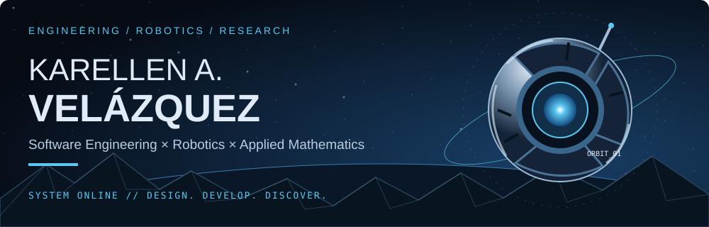
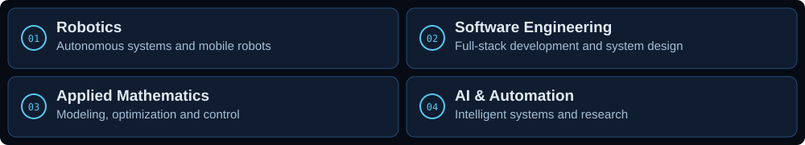

[GitHub](https://github.com/Velazquez-karellen) · [LinkedIn](https://www.linkedin.com/in/karellen-velazquez) · [Contact](mailto:karellen.velazquez@upr.edu)

## 01 // About Me

Software Engineering student at UPRM exploring software architecture, applied mathematics and autonomous robotic systems.

## 02 // Current Focus

## 03 // Engineering Toolkit

**Languages:** Python · C++  
**Applications:** Flutter · Laravel · Blade · Tailwind CSS  
**Data & APIs:** PostgreSQL · Supabase · REST APIs  
**Engineering:** Git · System modeling · Clean architecture

## 04 // Selected Projects

- **Autonomous Mobile Manipulation** — Research in mobile robotics.
- **AON Robotics** — Software and web development.
- **NENXORAS** — Software innovation.

## 05 // GitHub Activity

## 06 // Engineering Philosophy

I see software as the tension between order and expansion.  

Systems do not fail because they grow —  
they fail because they were never designed to grow.  

Structure is not decoration.  
It is foresight.  
Abstraction is not elegance.  
It is discipline.  

Every boundary defines responsibility.  
Every interface defines trust.  
Every architectural decision shapes what the system will tolerate tomorrow.  

Clarity is strength.  
Coherence is stability.  
Intentional design is endurance.  

I build with the future in mind —  
not as prediction,  
but as obligation.  

Engineering, to me, is the deliberate act of making complexity coherent  
without surrendering to it.

## 07 // Coding Activity

---

**THE BEST SYSTEMS ARE ALWAYS EVOLVING.** · `ORBIT_01`

