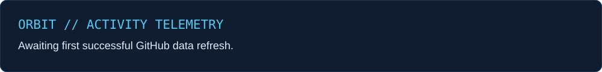

  

## 01 // About Me

My work focuses on software engineering, applied mathematics and autonomous robotics, combining software development, mathematical modeling and intelligent systems.

### Experience & Research

- **Autonomous Robotics Research** — Mobile manipulation, autonomous navigation and control.
- **AI Automation Research** — Intelligent agents, workflow automation and system integration.
- **[NENXORAS](https://github.com/NENXORAS)** — Founder; designing a modular intelligent software ecosystem.

## 02 // Current Focus

## 03 // Engineering Toolkit

**Languages:** Python · C++ · Dart · PHP  
**Applications:** Flutter · Laravel · Blade · Tailwind CSS  
**Data & APIs:** PostgreSQL · Supabase · REST APIs · FastAPI  
**Engineering:** Git · System modeling · Clean architecture · SolidWorks

## 04 // Selected Projects

- **Autonomous Mobile Manipulation** — Research in mobile robotics.
- **AI Automation Research** — Intelligent workflow automation.
### [NENXORAS](https://github.com/NENXORAS) — Founder

*Intelligence Connects More.*

Neural Ecosystem for Navigation, eXecution, Organization, Reasoning, Automation, and Synchronization.

A personal intelligent ecosystem designed to unify organization, financial awareness, automation, synchronization and AI-assisted decision support.

| Component | Focus |
| --- | --- |
| V.E.R.A. | Financial management and budgeting |
| A.T.L.A.S. | Tasks, scheduling and productivity |
| O.R.I.O.N. | Intelligent assistance and orchestration |

**Current stage:** Foundation documentation complete; implementation design and planning in progress. Core infrastructure and application MVPs are planned.

**Technical direction:** Flutter, Dart, Python, FastAPI and PostgreSQL, with offline capability, modular architecture and explicit authorization for AI-prepared changes.

[Explore the organization](https://github.com/NENXORAS)

## 05 // GitHub Activity

*Telemetry reflects data accessible to the GitHub Actions token.*

## 06 // Coding Activity

---

**THE BEST SYSTEMS ARE ALWAYS EVOLVING.** · `ORBIT_01`

