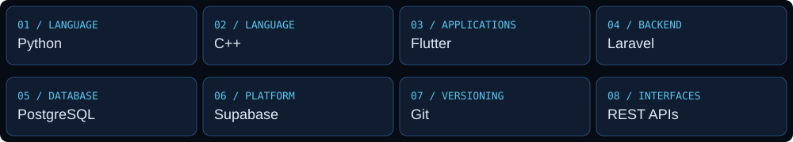
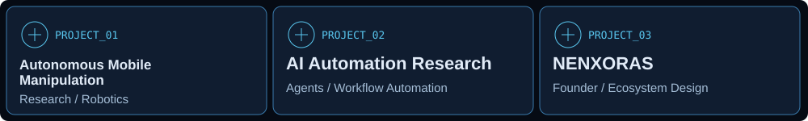

   

## 01 // About Me

Software Engineering student at the University of Puerto Rico at Mayagüez (UPRM), with studies in Applied Mathematics and a research interest in autonomous mobile manipulation, robotics and control. My work spans full-stack development, software architecture and AI-driven workflow automation.

### Experience & Research

- **AON Robotics** — Web Development Lead and Software Division member; developing web platforms and mobile applications.
- **Undergraduate Research** — Autonomous mobile manipulation, navigation, mathematical modeling and optimization.
- **Administrative AI Automation** — Research and development of workflow automation and agent integration.
- **Women in Engineering (IEEE WIE)** — Leadership and STEM outreach.

## 02 // Current Focus

## 03 // Engineering Toolkit

**Languages:** Python · C++ · Dart · PHP  
**Applications:** Flutter · Laravel · Blade · Tailwind CSS  
**Data & APIs:** PostgreSQL · Supabase · REST APIs · FastAPI  
**Engineering:** Git · System modeling · Clean architecture · SolidWorks

## 04 // Selected Projects

- **Autonomous Mobile Manipulation** — Research in mobile robotics.
- **AON Robotics** — Software and web development.
- **NENXORAS** — Software innovation.
- **[Personal Portfolio](https://github.com/Velazquez-karellen/karellen-portfolio)** — Personal web development project.

## 05 // GitHub Activity

## 06 // Coding Activity

---

**THE BEST SYSTEMS ARE ALWAYS EVOLVING.** · `ORBIT_01`

